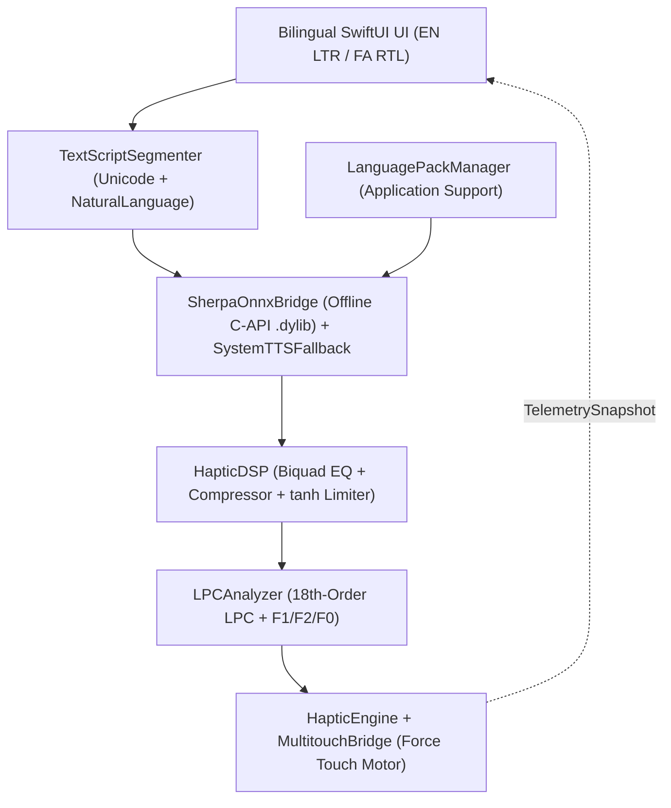

<div align="center">


# TapticVoice Studio

### 100% Offline Haptic Acoustic Voice Synthesizer for MacBook Trackpads

[](https://github.com/hosseinMsh/TapticVoice/actions/workflows/ci-cd.yml)
[](https://github.com/hosseinMsh/TapticVoice/releases)
[](https://apple.com)
[](https://apple.com)
[](#offline-multi-language-tts)
[](LICENSE)

*Mute your Mac. Your Force Touch trackpad will speak — completely offline.*

[Key Features](#-key-features) • [Offline Multi-Language TTS](#-offline-multi-language-tts) • [Acoustics & DSP](#-the-science--acoustic-dsp) • [Architecture](#-system-architecture) • [Quick Start](#-quick-start) • [فارسی](#-راهنمای-فارسی-persian-overview)

</div>

---

## 💡 Overview

A MacBook Force Touch trackpad contains **no loudspeaker** — only a precision linear resonant haptic motor beneath the glass.

**TapticVoice Studio** drives that motor up to **4,000 times per second** via Apple's private `MultitouchSupport` framework, vibrating the trackpad glass at extracted vocal-tract resonances ($F_1, F_2$) and pitch periods ($F_0$) so you hear intelligible speech straight from the glass.

Designed exclusively for **macOS (`arm64` & `x86_64`)** as a self-contained `.app` bundle, **TapticVoice v0.2.0** requires **zero Python, zero FFmpeg, zero Homebrew, and zero internet access** for core English & Persian synthesis.

---

## ✨ Key Features

- **100% Offline & Self-Contained:** Built-in universal2 `sherpa-onnx` C-API engine with quantized `int8` tiny neural voices for **Persian (`fa_IR`)** and **English (`en_US`)** embedded directly inside `TapticVoice.app`, plus native `AVSpeechSynthesizer` fallback.
- **Downloadable Offline Language Packs:** Download additional `int8` neural voice packs (Arabic, Turkish, French, German, Spanish, Italian, Russian, Chinese) in-app once and run offline anytime.
- **Mixed-Script Auto Segmentation:** Type mixed Persian + English sentences (e.g., `"سلام! اپلیکیشن TapticVoice عالی است."`); `TextScriptSegmenter` routes each chunk to its native voice and crossfades seamlessly.
- **Bilingual UI (EN ↔ فارسی):** Switch live between English (LTR) and Persian (RTL) directly from the toolbar.
- **Pro Acoustic & Haptic Controls:**
  - Acoustic Profiles: **Clear**, **Loud**, **Tactile**, and **Custom**.
  - Fine Tuning: **Speech Speed** (`0.7x–1.4x`), **Pitch Shift** (`±6` semitones), **Formant Clarity ($F_2$ Emphasis)**, **Loudness Compression**, **Motor Intensity**, and **External Magic Trackpad 2+** priority toggle.
- **Jitter-Free 30 FPS Visualizer:** Lock-protected `TelemetrySnapshot` rendering live $F_0, F_1, F_2$ frequency readouts without blocking the real-time haptic audio thread.

---

## 🌍 Offline Multi-Language TTS

| Tier | Languages | Model / Runtime | Storage |
| :--- | :--- | :--- | :--- |
| **Built-in (Always Offline)** | 🇮🇷 Persian (`fa_IR`), 🇺🇸 English (`en_US`) | Piper VITS `int8` via `sherpa-onnx` | Embedded in `.app` |
| **In-App Downloadable** | 🇸🇦 Arabic, 🇹🇷 Turkish, 🇫🇷 French, 🇩🇪 German, 🇪🇸 Spanish, 🇮🇹 Italian, 🇷🇺 Russian, 🇨🇳 Chinese | Quantized `int8` Piper VITS (13–21 MB each) | `~/Library/Application Support/TapticVoice/Models` |
| **System Fallback** | macOS installed voices | Native `AVSpeechSynthesizer` | 0 MB |

---

## 🔬 The Science & Acoustic DSP

The trackpad radiates sound between **100 Hz and 4,000 Hz** (+16 dB to +34 dB), peaking near **1 kHz**:

```text
  100–300 Hz (F0)       800–1,200 Hz (F1)       1,800–2,800 Hz (F2)      2,800–4,000 Hz
  [Tactile Buzz] ─────▶ [Glass Sweet Spot] ────▶ [Consonant Clarity] ───▶ [Fricatives: s/sh/f]
```

**Pure Swift Signal Processing Chain (`HapticDSP` + `LPCAnalyzer`):**
1. **Resampling (`AudioResampler`):** Normalizes all TTS voices to `16 kHz Float32` mono in memory.
2. **Biquad Filtering (`HapticDSP`):** Cuts sub-audible `<120 Hz` coil rumble and `>3.8 kHz` chatter, boosts `1 kHz` and `2.2 kHz` glass resonances, compresses dynamic range, and applies `tanh` soft limiting.
3. **18th-Order LPC (`LPCAnalyzer`):** Levinson-Durbin recursion + Durand-Kerner root solver extracts smoothed $F_1, F_2$ and $F_0$ every `10 ms`.
4. **Hardware Actuation (`MultitouchBridge`):** Re-triggers $F_1 + F_2$ Gaussian-windowed sine tones on every pitch period via `MTActuationActuate`.

---

## 📐 System Architecture



---

## 🚀 Quick Start

### Option A: Download Prebuilt App (Recommended)
1. Download `TapticVoice-v0.2.0-macOS.zip` from **[GitHub Releases](https://github.com/hosseinMsh/TapticVoice/releases)**.
2. Unzip and move **`TapticVoice.app`** to `/Applications`.
3. Open **TapticVoice** (if Gatekeeper prompts on unsigned/ad-hoc app: *Right-click -> Open*, or run `xattr -cr /Applications/TapticVoice.app`).

### Option B: Build From Source (macOS 13+)
```bash
git clone https://github.com/hosseinMsh/TapticVoice.git
cd TapticVoice

# Download & cache universal2 Sherpa-ONNX dylibs + tiny EN/FA offline models
./apps/TapticVoice/scripts/fetch_deps.sh

# Run unit tests & offline synthesis verification
./apps/TapticVoice/scripts/run_tests.sh

# Build self-contained TapticVoice.app
./apps/TapticVoice/build_app.sh
open apps/TapticVoice/build/TapticVoice.app
```

> **Tip for Best Loudness:** Place your MacBook on a hard wooden desk (acts as an acoustic soundboard) and keep your fingers off the glass during playback.

---

## 📚 Developer Documentation

- **[AGENT.md](AGENT.md):** Architecture overview, technical invariants, and AI agent development guide.
- **[RULES.md](RULES.md):** Coding standards, bilingual UI requirements, DSP safety limits, and Git hygiene.
- **[CHANGELOG.md](CHANGELOG.md):** Detailed version history.

---

## 🇮🇷 راهنمای فارسی (Persian Overview)

اپلیکیشن **TapticVoice Studio** مک‌بوک شما را **بدون نیاز به بلندگو و به صورت کاملاً آفلاین** به یک مولد صوت هپتیک تبدیل می‌کند:

- **کاملاً آفلاین و مستقل:** موتور بومی `sherpa-onnx` همراه با مدل‌های فشرده عصبی **فارسی (`fa_IR`)** و **انگلیسی (`en_US`)** داخل خود فایل `.app` قرار دارد (بدون نیاز به پایتون، Homebrew یا اینترنت).
- **پشتیبانی از جملات ترکیبی و دانلود زبان‌های بیشتر:** تشخیص خودکار متون ترکیبی فارسی و انگلیسی و امکان دانلود آفلاین زبان‌های عربی، ترکی، فرانسوی، آلمانی، اسپانیایی، ایتالیایی، روسی و چینی از داخل برنامه.
- **رابط کاربری دو زبانه و کنترل‌های حرفه‌ای صدا:** تغییر آنی زبان برنامه بین فارسی (RTL) و انگلیسی (LTR)، انتخاب پروفایل‌های آکوستیک (`شفاف`، `بلند`، `لرزشی`، `دستی`) و تنظیم وضوح حروف ($F_2$)، زیر و بمی، سرعت و شدت موتور هپتیک.

---

## 📄 License

Licensed under the [MIT License](LICENSE). Original trackpad actuation concept inspired by [nospeaker](https://github.com/os6/nospeaker) by Cody Collier; offline TTS powered by [sherpa-onnx](https://github.com/k2-fsa/sherpa-onnx) and Piper VITS voices.
