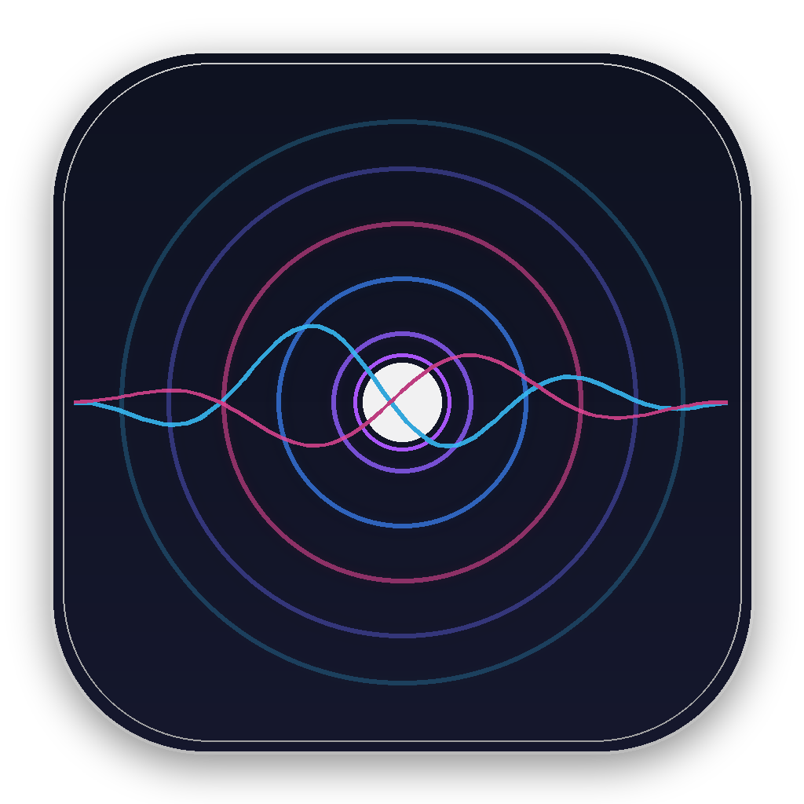
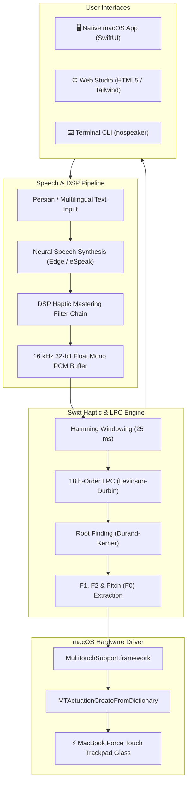

<div align="center">



# TapticVoice Studio
### Haptic Acoustic Voice Synthesis on MacBook Force Touch Trackpads

[](https://github.com/hosseinMsh/TapticVoice/actions/workflows/ci-cd.yml)
[](https://github.com/hosseinMsh/TapticVoice/releases)
[](https://apple.com)
[](https://swift.org)
[](https://developer.apple.com/xcode/swiftui/)
[](https://apple.com)
[](LICENSE)

*Mute your Mac. Your trackpad will speak anyway.*

[Features](#-key-features) • [The Science](#-the-science--engineering) • [Architecture](#-system-architecture) • [App UI/UX](#-native-macos-app) • [Quick Start](#-quick-start) • [فارسی](#-راهنمای-فارسی-persian-overview)

</div>

---

## 💡 Overview

There is **no speaker** inside a MacBook trackpad — only a small linear resonant haptic motor that vibrates the glass surface to simulate a mechanical click. 

**TapticVoice** drives that motor up to **4,000 times a second**, exciting the natural mechanical modes of the trackpad's glass plate and converting it into a voice synthesizer. It extracts vocal tract resonance formants ($F_1, F_2$) and fundamental pitch ($F_0$) using **Linear Predictive Coding (LPC)** and actuates the hardware directly via Apple's private `MultitouchSupport` framework.

This project delivers:
1. 🖥️ **A Native macOS SwiftUI Application (`TapticVoice.app`)** with a glassmorphic interface, real-time 60fps formant visualizer, pitch/speed tuning, and Apple keyboard shortcuts.
2. 🎙️ **Neural Speech Pipeline with Persian & Multi-Language Optimization**, producing natural speech.
3. 🎛️ **Haptic DSP Mastering Chain** conditioning frequencies for the physical 100 Hz – 4,000 Hz acoustic response curve of the MacBook trackpad.
4. 🌐 **A Standalone Web Control Studio & API** for remote triggering, audio preview, and waveform monitoring.
5. ⌨️ **A High-Performance CLI Tool** for terminal-based operation and scripting.

---

## ✨ Key Features

- **Direct Hardware Actuation:** Resolves Apple's private `MultitouchSupport.framework` dynamically (`MTDeviceCreateList`, `MTActuatorCreateFromDeviceID`, `MTActuationCreateFromDictionary`, `MTActuationActuate`).
- **Real-Time Linear Predictive Coding (LPC):** 18th-order Levinson-Durbin autocorrelation recursion, polynomial root finding via Durand-Kerner method, and dynamic formant tracking every 10 ms.
- **Dedicated Haptic Mastering DSP:**
  - High-pass filtering at 120 Hz (eliminating sub-audible rumble that saturates motor coils).
  - Low-pass filtering at 3,800 Hz (preventing high-frequency actuator buzz).
  - Dual parametric peaking EQ (+3.5 dB @ 1 kHz sweet spot, +4.0 dB @ 2.2 kHz intelligibility presence).
  - Dynamic audio compression leveling out consonant and vowel energies.
- **Native macOS App Bundle:** Built with Swift 6 and SwiftUI, styled with Apple Human Interface Guidelines, Retina `.icns` icon, and ad-hoc codesigned.
- **Real-time 60 FPS Visualizer:** Live canvas displaying $F_0$ pitch beats, $F_1/F_2$ formant frequencies, and actuation intensity.

---

## 🔬 The Science & Engineering

### 1. Acoustic Resonance Curve (100 Hz to 4,000 Hz)

Measured with the MacBook's own studio microphones, the trackpad's acoustic output ranges from **+16 dB to +34 dB**:

```text
  Loudness
   (+34 dB) ──┐                                   ### (1 kHz Sweet Spot)
              │                       #+#     +++#####        #
              │                      +#+#+   .+++#####       .#
              │           .       ++++#+#+   .+++#####    # #.# #
              │ ++       +. . #..+++++#+#++++.+++#####+ #####.###          .#
   (+16 dB) ──┴─────────────────────────────────────────────────────────────
             100 Hz      250 Hz      500 Hz      1 kHz       2 kHz       4 kHz
             [Pitch F0]              [Formant F1]            [Formant F2] [Sibilance]
             Mechanical Haptics      Vowel Acoustic Core     Consonant Clarity
```

- **100 – 300 Hz ($F_0$ Fundamental Pitch):** Produces powerful tactile physical vibration. Retriggers pulses on every pitch period ($1/f_0$), giving the synthesized sound vocal buzz rather than synthetic whistling.
- **800 – 1,200 Hz ($F_1$ Sweet Spot):** The loudest and cleanest resonance peak of the glass plate (+34 dB). Carries the primary acoustic power of vowels.
- **1,800 – 2,800 Hz ($F_2$ Clarity & Formants):** Crucial for speech intelligibility and consonant differentiation. Boosted in DSP to overcome the glass damping curve.
- **2,800 – 4,000 Hz (Fricatives & Transients):** High-frequency bursts for unvoiced consonants (s, sh, f, t).

---

## 📐 System Architecture



---

## 🖥️ Native macOS App

The app is packaged as a standard macOS application (`TapticVoice.app`):

- **Window:** Translucent glassmorphism with `NSVisualEffectView`.
- **Controls:**
  - **Pitch:** -30 Hz to +30 Hz with haptic center snap.
  - **Speed:** -30% to +40% tempo variation.
  - **Intensity:** 50% to 100% actuator power slider.
  - **Mastering Toggle:** Enable/disable the 100–4000 Hz haptic EQ & compression.
- **Shortcuts:**
  - `⌘ + Return`: Play on Trackpad (Actuate Taptic Motor).
  - `⌘ + P`: Audio Preview in Speakers.
  - `Esc`: Emergency Stop.

---

## 🚀 Quick Start

### Option A: Build and Run Native macOS App

Requires macOS 12+ and Command Line Tools (`xcode-select --install`):

```bash
# Clone the repository
git clone https://github.com/hosseinMsh/TapticVoice.git
cd TapticVoice

# Build the native macOS application bundle
./apps/TapticVoice/build_app.sh

# Open the App
open apps/TapticVoice/build/TapticVoice.app
```

*Or package a distributable `.zip`:*
```bash
./package_release.sh
# Created at: dist/TapticVoice-macOS.zip
```

### Option B: Run Web Control Studio

```bash
python3 server.py 8089
# Open in browser: http://localhost:8089
```

### Option C: CLI Tool

```bash
# Build the CLI
./build.sh

# Play text
./nospeaker "Hello from the glass trackpad"

# Play with custom audio file
./nospeaker --file build/audio/speech_16k.wav "Persian Voice"
```

---

## 🎧 Tips for Maximum Volume and Clarity

1. **Place your MacBook on a wooden desk:** The aluminum unibody transfers vibrations through the rubber feet into the desk, turning the table into an acoustic soundboard and **doubling perceived loudness**.
2. **Hands off the glass during speech:** Touching the trackpad damps frequencies above 500 Hz, muffling consonant clarity.
3. **Mute your speakers:** To appreciate the magic of pure haptic acoustics with zero speaker involvement.

---

## 🇮🇷 راهنمای فارسی (Persian Overview)

پروژه **TapticVoice Studio** تبدیل‌کننده موتور لرزش لمسی (Force Touch Taptic Engine) مک‌بوک به یک **بلندگوی صوتی مبتنی بر ارتعاش شیشه** است.

### ویژگی‌های کلیدی برای زبان فارسی:
- **سنتز گفتار روان فارسی:** مدل پیشرفته عصبی هوش مصنوعی با تلفظ دقیق و پیوسته واژگان، بدون لهجه یا حس رباتیک.
- **مسترینگ صوتی بازه ۱۰۰ تا ۴۰۰۰ هرتز:** تفکیک فرکانس‌های رزونانس ($F_1$ در ۱ کیلوهرتز و $F_2$ در ۲.۲ کیلوهرتز) برای رسایی فوق‌العاده روی شیشه ترک‌پد.
- **اپلیکیشن بومی مک‌بوک (`TapticVoice.app`):** رابط کاربری مدرن با فریم‌ورک SwiftUI، تم شیشه‌ای تاریک، ویژوالایزر ۶۰ فریم بر ثانیه، آیکون رتینا و کلیدهای میانبر `⌘↵` و `⌘P`.
- **وب‌پنل تحت وب:** محیط گرافیکی کامل برای تست و ارسال پیام در آدرس `http://localhost:8089`.

### نحوه اجرا:
```bash
# اجرای خودکار ساخت پکیج مک‌بوک
./apps/TapticVoice/build_app.sh
open apps/TapticVoice/build/TapticVoice.app
```

---

## 🛠️ Tech Stack & Technologies

- **Languages:** Swift 6.3, Python 3.13, Shell (Bash/Zsh)
- **Frameworks:** SwiftUI, AppKit, AVFoundation, CoreAudio, IOKit
- **Private APIs:** `MultitouchSupport.framework` (Dynamic Loading)
- **Signal Processing:** 18th-Order Linear Predictive Coding (LPC), Levinson-Durbin Recursion, Durand-Kerner Root Finding, FFT
- **Audio DSP:** FFmpeg (Bandpass, Parametric Peaking EQ, Dynamic Range Compression)
- **Web:** HTML5, CSS3, Tailwind CSS, JavaScript ES6+

---

## 📄 License

This project is licensed under the [MIT License](LICENSE).  
Original research based on [nospeaker](https://github.com/os6/nospeaker) by Cody Collier. Extended with native macOS SwiftUI architecture, neural speech engine, and acoustic DSP mastering.
